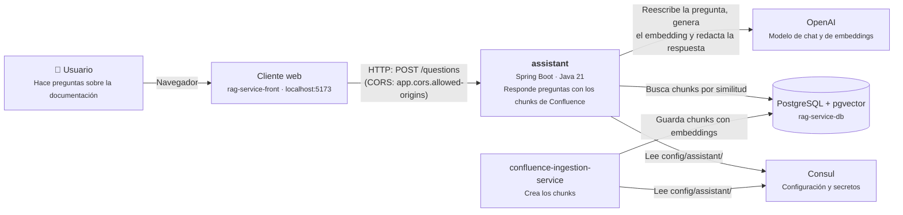
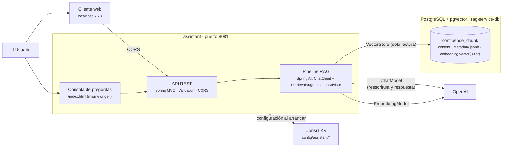
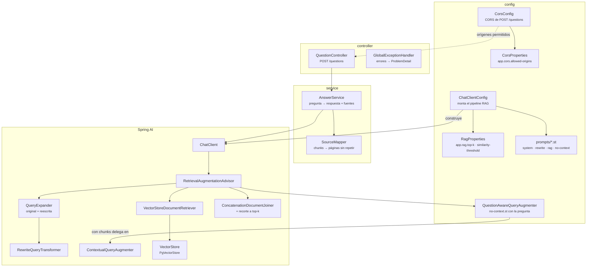
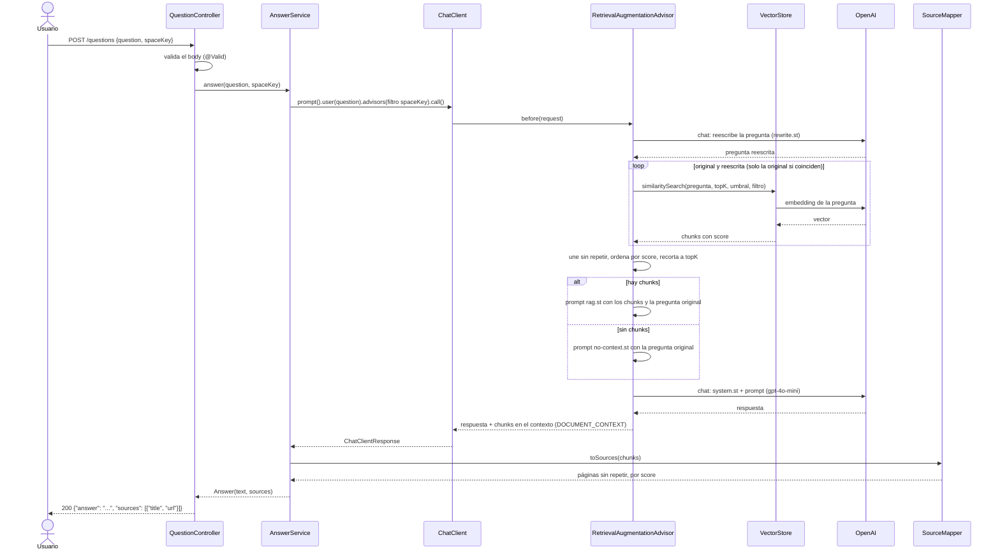
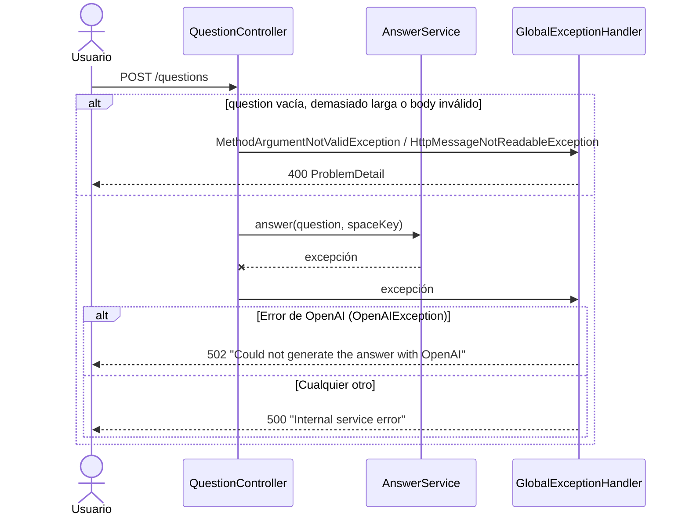
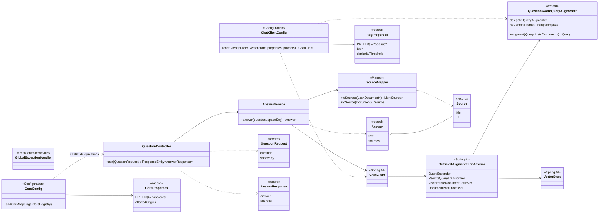

# Arquitectura de assistant

Diagramas del diseño actual: C4 (contexto, contenedores y componentes), secuencia de una
pregunta y de los errores, y clases. Están en Mermaid, así que se ven directamente en GitHub o
GitLab.

## C4 nivel 1: contexto

## C4 nivel 2: contenedores

El servicio no crea ni modifica tablas: `confluence_chunk` la gestiona el servicio de ingesta con
Liquibase, y `spring.ai.vectorstore.pgvector.initialize-schema` está a `false` en Consul.

## C4 nivel 3: componentes

`AnswerService` no busca ni construye prompts: eso lo hace el advisor dentro del `ChatClient`. El
service solo aporta el filtro por `spaceKey` por petición y lee del contexto de la respuesta los
chunks que el advisor recuperó, para convertirlos en fuentes. El expander busca con la pregunta
original y con la reescrita, porque la reescritura puede cambiar el sentido de una palabra ambigua;
el joiner une ambos resultados sin repetir y por score, y un post-procesador los recorta a `top-k`.
`QuestionAwareQueryAugmenter` conserva la pregunta en el prompt sin contexto, para que el modelo
responda en su idioma.

## Secuencia: pregunta

`POST /questions` con `{"question": "...", "spaceKey": "DS"}`. El `spaceKey` es opcional.

Cada pregunta hace cuatro llamadas a OpenAI: reescritura, dos embeddings y respuesta; tres si la
reescritura no cambia la pregunta. La pregunta reescrita solo se usa para buscar; el modelo responde
a la pregunta original.

## Secuencia: errores

## Diagrama de clases

Para no sobrecargar el diagrama se omiten `AnswerResponseMapper`, `SourceResponse` y las clases de
constantes (`ApiPaths`, `PromptPaths`, `ChunkMetadata`, `ErrorMessages`).
